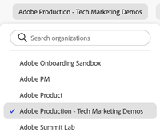
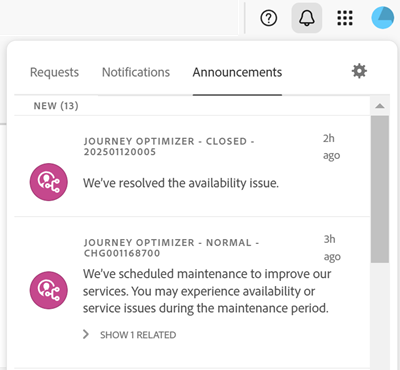
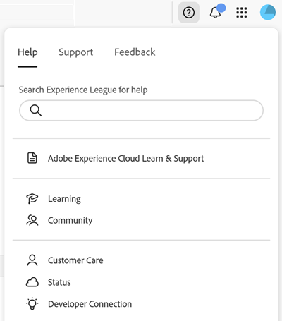

# Get started using CX Enterprise {#get-started}

Sign in to [Adobe CX Enterprise](https://experience.adobe.com) to launch your applications, then use the unified header to manage your profile, check notifications, and find help, all from one place.

## Before you begin {#before-you-begin}

You need an Adobe ID that has been provisioned for your organization's CX Enterprise products. If you can't sign in or don't see the applications you expect, contact your [!UICONTROL CX Enterprise] [administrator](administration/admin-console.md).

## Sign in to CX Enterprise {#sign-in}

Sign in and verify that you are in the right [organization](administration/organizations.md).

1. Navigate to [Adobe CX Enterprise](https://experience.adobe.com).
1. Type your Adobe email address, then click **[!UICONTROL Continue]**.
1. Click an account. 
1. Type your password.
1. Verify that you are in the right organization.

   

   **Verify your organization** 

   The [organization](administration/organizations.md) is displayed in the interface header.

   If your organization uses Federated IDs, CX Enterprise allows you to sign in with your organization's single sign-on without being required to enter your email address and password. Add `#/sso:@domain` to the CX Enterprise URL (`https://experience.adobe.com`) to accomplish this task.
    
   For example, for an organization with Federated IDs and the domain `example.com`, set your URL link to `https://experience.adobe.com/#/sso:@example.com`. You can also go directly to a specific application by bookmarking this URL, appended with the application path. (For example, for Adobe Analytics, `https://experience.adobe.com/#/sso:@example.com/analytics`.)
   
   **Note:** The administrator of your organization may restrict access to Adobe products by IP addresses. If so, you may receive an error after logging into CX Enterprise or switching to an organization with this enabled. More information is available in [Limit product access by IP addresses](https://helpx.adobe.com/enterprise/using/ip-based-access.html).

## Access CX Enterprise applications {#applications}

After signing in to CX Enterprise, you can quickly access all your applications, services, and organizations from the unified header.

To access CX Enterprise applications and services provisioned for you within your organization, go the application selector .

## Manage your user profile {#profile}

In the [!UICONTROL Profile] menu, you can:

* Specify a dark theme (not all applications support this theme)
* Manage CX Enterprise [Preferences](features/account-preferences.md)
* Select or search for an [Organization](administration/organizations.md)
* View [!UICONTROL Legal Notices]
* Sign out
* Configure account preferences, notifications, and subscriptions

## View in-product notifications and announcements {#notifications}

Click the bell icon to view notifications and announcements. Announcements can be relevant and actionable updates, including product releases, maintenance notices, shared items, and approval requests.

To manage notifications and alerts, see [Account preferences and notifications](features/account-preferences.md).

## Get help and support {#help}

Access learning and help using the **[!UICONTROL Help center]** () in the header, including help content (documentation, tutorials, and courses) on [Experience League](https://experienceleague.adobe.com/#home), as well as additional resources for individual applications. You can also submit open-ended feedback and create prioritized support tickets.

The [!UICONTROL Help] menu also gives you access to:

* **[!UICONTROL Support]:** Create a support ticket or contact [!UICONTROL Support] using Twitter.
* **[!UICONTROL Feedback]:** Share feedback about your CX Enterprise experience. Your feedback is used to improve Adobe's products and services.
* **[!UICONTROL Status]:** Navigate to `https://status.adobe.com/experience_cloud` and check product operational status and [!UICONTROL Manage Subscriptions].
* **[!UICONTROL Developer Connection]:** Navigation to `adobe.io` and find developer documentation.

## More help on this topic {#more-help}

* [User and product management in the Admin Console](administration/admin-console.md)
* [Get started with the People service](services/getting-started.md)
* [Account preferences and notifications](features/account-preferences.md)
